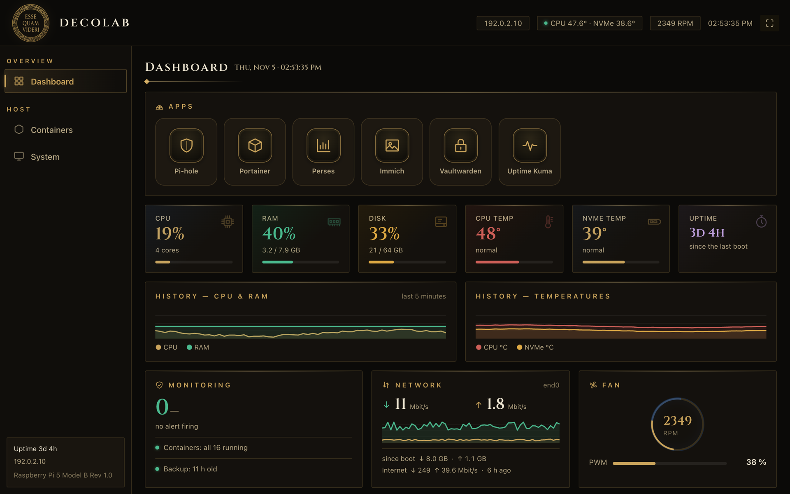
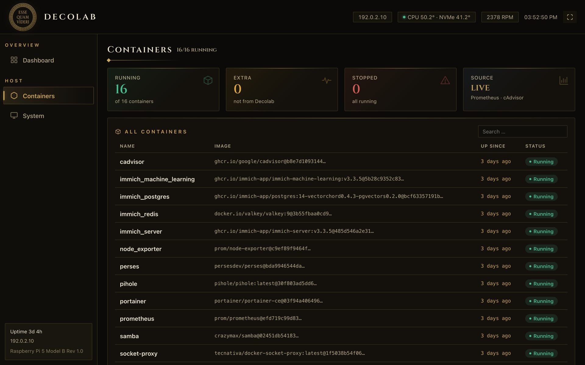

# Decolab (Kurzfassung)

*Esse quam videri* (Sein statt Scheinen).

Decolab macht aus einem Raspberry Pi 5 einen Heimserver, der **beweist**, dass er
funktioniert, statt nur gesund auszusehen. Sicherungen werden automatisch
wiederhergestellt und geprüft. Wächter prüfen, ob jeder Dienst seine Arbeit tut,
nicht nur, ob der Container läuft. Die Voreinstellungen sind gehärtet, das
Dashboard ist im Art-Deco-Stil.

> **Stand: frühe Fassung (v0.1.0).** Das Projekt wird aus
> einem privaten Homelab herausgelöst, das täglich im Einsatz ist. Bis zur
> Version 1.0 ändert sich noch viel: erst auf einem Ersatz-Pi ausprobieren.
> Nur arm64 (Raspberry Pi 5).

Mehr: die Container-Liste

*Erfundene Werte, aus `tools/demo-panel.sh`.*

Die vollständige Beschreibung steht im [englischen README](README.md).

**Inhalt:** Pi-hole mit Unbound, Prometheus, Perses, Uptime Kuma, Portainer,
Watchtower, Samba-NAS, wahlweise Immich und Vaultwarden, dazu Lüfter, OLED, NVMe
und USV für den Pi 5.

**Konfiguration:** eine einfache Datei im Format `SCHLÜSSEL=WERT`
([decolab.conf.example](decolab.conf.example)). Sie wird vor der Verwendung
geprüft und nie ausgeführt. Geheimnisse entstehen erst bei der Installation und
liegen außerhalb des Repos.

**Anleitungen** (englisch): [Installation](INSTALL.md),
[Wiederherstellung](RESTORE.md), [Sicherheitsmodell](docs/security.md),
[Zeitplan](docs/schedule.md). Sicherheitslücken bitte vertraulich melden:
[SECURITY.md](SECURITY.md).

**Lizenz:** wahlweise [MIT](LICENSE-MIT) oder [Apache-2.0](LICENSE-APACHE).
Ohne Gewähr und ohne Support. Fragen und Ideen (gern auf Deutsch; Antworten,
wenn Zeit ist):
[Discussions](https://github.com/DanielEnki420/decolab/discussions), Fehler:
[Issues](https://github.com/DanielEnki420/decolab/issues).
