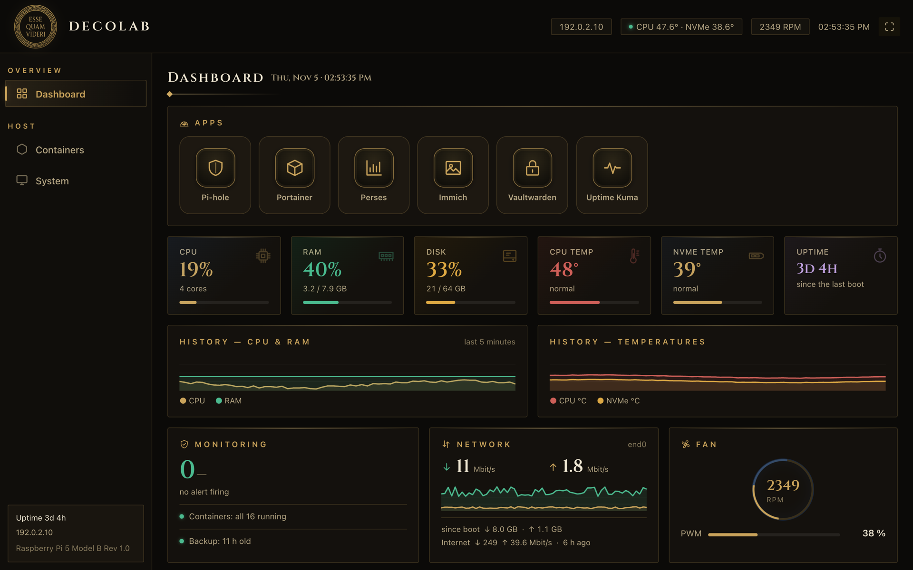
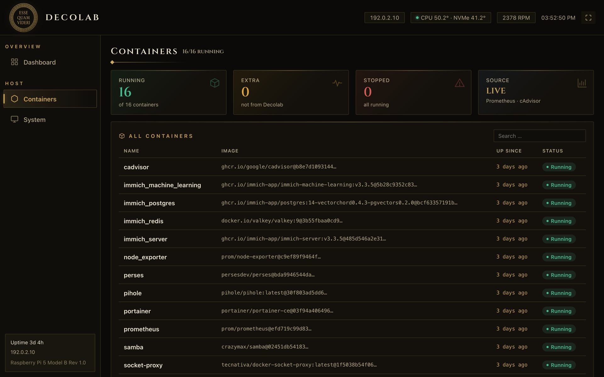

# Decolab

[](https://scorecard.dev/viewer/?uri=github.com/DanielEnki420/decolab)
[](https://www.bestpractices.dev/projects/16500)

*Esse quam videri* (to be, rather than to seem).

Decolab turns a Raspberry Pi 5 into a self-hosted home server that **proves** it
works instead of just looking healthy. Backups are restored automatically and
checked. Monitors check that each service does its job, not only that the
container is up. Defaults are hardened. The dashboard has an Art Deco look.

> **Status: early (v0.3.0).** The project is extracted
> from a private homelab that runs in daily use. Until version 1.0,
> expect breaking changes, and test it on a spare Pi. **arm64 only**
> (Raspberry Pi 5).

[Deutsche Kurzfassung](README.de.md)



<details>
<summary>More: the container list</summary>



</details>

*Made-up values, from `tools/demo-panel.sh`.*

## What it will set up

| Area | Services |
|---|---|
| DNS | Pi-hole with Unbound (recursive, DNSSEC-validating) |
| Monitoring | Prometheus, node_exporter, cAdvisor, Perses dashboards, Uptime Kuma |
| Management | Portainer and Watchtower, both behind a Docker socket proxy |
| Storage | Samba NAS share |
| Optional modules | Immich (photos), Vaultwarden (passwords) |
| Pi 5 hardware | Fan control, OLED status display, NVMe health, UPS via NUT (detected automatically) |

The software above is pulled as container images from each publisher. Decolab
does not ship it and is not affiliated with any of these projects (see [NOTICE](NOTICE)).

## Setup in short

`bin/decolab-config init` writes the configuration. It finds what it can and
asks for the rest; Enter accepts the suggestion. Then `install.sh` does the rest
([INSTALL.md](INSTALL.md) has every step).

```text
$ bin/decolab-config init
Decolab setup: Enter accepts the suggestion in [brackets].

== Network ==
LAN network interface [eth0]:
Fixed LAN address of this Pi [192.0.2.15]:
LAN network [192.0.2.0/24]:
SSH port [22]:

== Remote access ==
Use Tailscale for the web interfaces (HTTPS) [yes]:
Tailnet name (the part before .ts.net) [tail1234]:

== Modules ==
Immich (photos) [yes]:
Vaultwarden (passwords; needs Tailscale) [yes]: no
...
Wrote /opt/decolab/decolab.conf (29 settings).
Before you install:
  - 192.0.2.15 came from DHCP: reserve it for this Pi in your router.
Next: read it once, then run ./install.sh --dry-run --fresh
```

*Shortened; made-up addresses. Every answer is checked at once, the whole file
again before it is written.*

## Documentation

| | |
|---|---|
| [INSTALL.md](INSTALL.md) | from an empty Pi to a running system |
| [RESTORE.md](RESTORE.md) | rebuilding from a backup, and going back after an update |
| [docs/security.md](docs/security.md) | what Decolab protects against, and what it does not |
| [docs/schedule.md](docs/schedule.md) | what runs when |
| [docs/panel.md](docs/panel.md) | the read-only dashboard and its API |
| [docs/metrics.md](docs/metrics.md) | Decolab's own Prometheus metrics |
| [SECURITY.md](SECURITY.md) | reporting a vulnerability |

## Principles

1. **Correctness over reachability.** A check counts only if it would fail
   when the service stops doing its job.
2. **Backups are tested.** Every night a restore probe restores the newest
   backup in isolation and checks that it gives a usable service.
3. **Allow lists, not deny lists.** Firewall rules, copied files and network
   access are listed positively.
4. **Nothing hidden in the configuration.** One plain `KEY=VALUE` file
   ([decolab.conf.example](decolab.conf.example)), validated before use, never
   executed. Secrets are generated at install time and stay outside the repository.
5. **No change without a way back.** Hardening steps are opt-in and reversible.

## Roadmap

Decolab stays Shell and Python on purpose. The Python code uses only the
standard library and the dashboard is hand-written HTML, CSS and JavaScript
without a build step. A release is therefore nothing but signed source code:
no compiler, no package downloads, nothing that is not in the tag.

Planned next: stricter static checks for the Python code in CI.

## Development

```bash
tools/setup-dev.sh        # installs the git hooks (needs git, gitleaks)
tools/check.sh            # everything CI runs: shellcheck, guard, gitleaks, tests
tests/run.sh              # only the contract tests (need Docker)
bin/decolab-config check decolab.conf.example
tools/demo-panel.sh       # the dashboard with made-up values, on http://127.0.0.1:8099/
```

Every commit passes through `tools/guard.sh` and gitleaks. The guard rejects
private and public IP addresses, MAC addresses, UUIDs, personal paths, e-mail
addresses and a personal word list, in files and in commit messages. The
tests are contract tests: they check what a script promises (its output, its
files, its HTTP API), not how it is written, so they stay valid when a script
is rewritten. Examples
use the documentation ranges `192.0.2.0/24` and `2001:db8::/32`.

## Support

Decolab is provided as is, without support or warranty.

- Questions, ideas, your setup: [Discussions](https://github.com/DanielEnki420/decolab/discussions)
  (a hobby project: answers come when time allows)
- Bugs: [Issues](https://github.com/DanielEnki420/decolab/issues)
- Security issues: privately, see [SECURITY.md](SECURITY.md)
- Contributing: [CONTRIBUTING.md](CONTRIBUTING.md)

## License

Licensed under either of [MIT](LICENSE-MIT) or [Apache-2.0](LICENSE-APACHE),
at your option.
